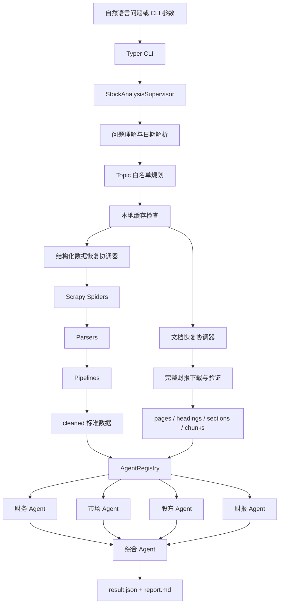

# get-stock 开发文档

文档版本：1.0  
对应项目版本：1.0.0  
对应 Supervisor 版本：1.4

本文面向项目维护者和后续功能开发者，说明当前已经实现的能力、源码架构、主要函数与类、
运行方式、数据契约、扩展接口和已知边界。面向普通命令行用户的说明见
[股票分析命令使用指南](analysis-user-guide.md)。

## 1. 项目说明

`get-stock` 是一个面向本地研究和低频验证的巨潮资讯股票数据采集与分析项目。用户可以按
六位股票代码采集公司、财务、行情、股东、交易、公告和财报 PDF 数据，也可以输入自然语言
问题，由 Supervisor 检查本地缓存、按白名单补采缺失数据、调度专业 Agent，并生成结构化结果
和 Markdown 综合报告。

当前设计目标是：

- 原始响应、正式清洗数据、人工查看数据、运行状态和分析产物分目录保存；
- Spider、Parser、Pipeline、Agent 和综合报告相互解耦；
- LLM 只处理受 Pydantic Schema 和 Topic 白名单约束的数据，不直接生成爬虫命令；
- 数据不足、单个 Agent 失败和 LLM 输出校验失败均有明确状态或降级结果；
- 爬取保持低频，遇到 403、429、HTML 或验证码响应时安全停止；
- 数据和 Agent 类型可以通过显式注册表继续扩展。

本项目不是交易系统，不预测股价，不生成买卖指令，也不提供投资建议。

## 2. 当前已经实现的能力

### 2.1 数据采集

| Spider | Scrapy 名称 | 已实现的数据 |
| --- | --- | --- |
| `CninfoAnnouncementSpider` | `cninfo_announcements` | 公告元数据、报告分类、可选 PDF 下载 |
| `CninfoCompanySpider` | `cninfo_company` | 公司资料、高管、分红历史 |
| `CninfoFinancialsSpider` | `cninfo_financials` | 财务摘要、财务指标、资产负债表、利润表、现金流量表 |
| `CninfoMarketSpider` | `cninfo_market` | 行情快照、日频历史行情 |
| `CninfoShareholdersSpider` | `cninfo_shareholders` | 股本结构、股东人数、基金持股、十大股东、十大流通股东、限售解禁、股权质押 |
| `CninfoTradingSpider` | `cninfo_trading` | 融资融券、大宗交易 |

公告采集能够区分：

- 普通公告 `regular_announcement`；
- 完整财务报告 `full_report`；
- 季度报告 `quarterly_report`；
- 报告摘要 `report_summary`；
- 单独财务报表 `financial_statements`；
- 审阅报告 `review_report`；
- 审计报告 `audit_report`；
- 其他报告相关公告 `report_related_notice`。

自动财报分析链只选择 `full_report`，不会把摘要、问询函、延期公告或审阅报告当成完整财报。

### 2.2 PDF 处理

已经实现：

- 下载后检查 PDF 文件头；
- 对完整财报前10页进行渐进验证，必要时最多扩展到20页；
- 验证股票简称、报告年度、报告类型和完整报告典型章节；
- 使用 `pypdf` 逐页提取文本；
- 清理重复页眉、页脚及空白；
- 规则检测章节边界；
- 可选使用 DeepSeek 对规则候选标题进行结构化分类；
- 保留无法归类的明确章节，不丢弃未知章节；
- 按章节、段落、页码生成可追溯 chunks；
- 使用源文件 SHA-256、处理器版本和切片参数判断缓存；
- 输出 `pages.jsonl`、`headings.jsonl`、`sections.jsonl`、`chunks.jsonl` 和 `manifest.json`。

### 2.3 Agent 分析

当前内置五个分析 Agent：

| Agent | 作用 |
| --- | --- |
| `financial_analysis` | 成长、盈利、盈利质量、资产负债、偿债、运营效率、现金流、分红和股本结构 |
| `market_trading` | 价格趋势、波动、流动性、价量、估值、融资融券和大宗交易 |
| `shareholder_analysis` | 股本、股东集中度、主要股东变化、股东人数、基金持股、解禁和质押 |
| `financial_report_analysis` | 从完整财报 chunks 补充业务、行业地位、市占率、技术、研发、风险和战略等定性事实 |
| `comprehensive_analysis` | 统一专业 Agent 结果、检查覆盖和冲突、生成综合 JSON 与 `report.md` |

另外实现了 `StockAnalysisSupervisor`，负责问题理解、规划、缓存检查、受控数据恢复、专业 Agent
执行、综合分析和最终产物写入。

## 3. 技术栈和运行要求

| 组件 | 用途 |
| --- | --- |
| Python 3.10+ | 运行环境 |
| Scrapy 2.11+ | HTTP 请求、Spider、Pipeline、重试和文件下载 |
| Pydantic 2 | 输入、任务、LLM 输出和最终结果校验 |
| pydantic-settings | `.env` 和应用配置加载 |
| Typer | CLI 命令 |
| pypdf | PDF 验证和逐页文本提取 |
| LangChain | DeepSeek 模型封装和结构化输出 |
| LangGraph | Supervisor/专业 Agent 图定义，目前为可选执行入口 |
| langchain-openai | 通过 OpenAI 兼容协议调用 DeepSeek |
| pytest | 单元、集成和联网冒烟测试 |
| Ruff | 代码规范检查 |

Scrapy 当前关键配置：

```python
ROBOTSTXT_OBEY = True
CONCURRENT_REQUESTS = 4
CONCURRENT_REQUESTS_PER_DOMAIN = 4
DOWNLOAD_DELAY = 5.0
RANDOMIZE_DOWNLOAD_DELAY = True
RETRY_TIMES = 2
```

`DOWNLOAD_DELAY` 可以通过 `.env` 中的 `GET_STOCK_DOWNLOAD_DELAY` 调整。并发数当前写在
`get_stock.settings` 中，不是环境变量。

## 4. 总体架构



系统的稳定边界是 `cleaned` 数据和各 Agent 的 Pydantic任务/结果。外部数据源发生变化时，优先
在 Spider 和 Parser 层完成适配，避免让 Agent 直接理解外部接口格式。

## 5. 源码目录

```text
src/get_stock/
├── cli.py                         # Typer 命令入口
├── config.py                      # .env 与应用配置
├── settings.py                    # Scrapy 配置
├── items.py                       # Scrapy Item 定义
├── parsers.py                     # 巨潮响应解析和标准化
├── storage.py                     # JSON/JSONL 原子写入和 pretty 转换
├── pdf_validation.py              # 完整财报下载后轻量验证
├── llm.py                         # DeepSeek ChatModel 工厂
├── spiders/                       # 六个业务 Spider 和公共 Mixin
├── pipelines/                     # 数据集写入、PDF下载和状态记录
├── middlewares/                   # 403/429/异常响应保护
├── documents/                     # PDF提取、清理、标题、章节和切片
├── acquisition/                   # 结构化数据自动补采
├── document_acquisition/          # 完整财报自动恢复和处理
├── agent_config/                  # 数据文件白名单和 Topic 映射
├── agent_plugins/                 # Agent 扩展注册契约
├── financial_agent/               # 财务 Agent
├── market_trading_agent/          # 市场交易 Agent
├── shareholder_agent/             # 股东 Agent
├── report_agent/                  # 财报定性 Agent
├── comprehensive_agent/           # 综合分析 Agent
└── supervisor/                    # 问题理解、计划、调度和总状态
```

## 6. 实际运行流程

### 6.1 单 Spider 流程

```text
CLI
→ CninfoBaseMixin.start()
→ 查询股票代码对应的 org_id、exchange、plate
→ Spider.start_data_requests()
→ Parser 将响应转换为统一记录
→ Item Pipeline 写入 cleaned
→ 可选同步到 pretty
→ 写入 state
```

所有 Spider 先解析证券身份并生成 `security.json`。`CninfoBaseMixin` 统一负责股票代码校验、
请求头、详情页 Referer、原始响应保存和证券身份解析。

### 6.2 Supervisor 自动分析流程

`StockAnalysisSupervisor.analyze()` 当前按以下顺序执行：

```text
understand()
→ plan()
→ recover()
→ recover_documents()
→ execute()
→ synthesize()
→ finalize()
```

具体职责：

1. `understand()`：提取股票代码、Topic、时间意图和文档意图；DeepSeek失败时使用规则结果。
2. `plan()`：将 Topic确定性映射到注册 Agent，构造专业任务并检查本地缓存。
3. `recover()`：`--auto-crawl` 开启时，只补采缺失的必需结构化数据。
4. `recover_documents()`：只有任务需要完整财报且获得授权时才恢复 PDF 和 chunks。
5. `execute()`：通过 `AgentRegistry` 顺序调用专业 Agent；单个失败会被隔离。
6. `synthesize()`：构造综合任务，综合 Agent只消费专业 Agent 已验证结果。
7. `finalize()`：汇总缺失数据、建议动作、状态和产物路径并写入 Supervisor 文件。

### 6.3 Agent 内部流程

结构化专业 Agent 通常执行：

```text
analyze() → prepare() → reason() → finalize()
```

- `prepare()`：校验任务、读取白名单文件、判断充分性、计算确定性指标和 Evidence；
- `reason()`：调用注入的 Reasoner，或者执行确定性降级；
- `finalize()`：验证 Topic、Evidence 和输出 Schema，生成正式结果。

财报 Agent 在 `prepare()` 后增加 `retrieve()`，按任务 Topic、heading 和关键词从授权的
`chunks.jsonl` 中筛选内容。综合 Agent 在 `prepare()` 中适配各专业结果、检查需求覆盖和冲突，
再进行综合推理。

### 6.4 LangGraph 当前状态

当前已经提供以下 Graph Builder：

- `build_supervisor_graph()`；
- `build_financial_graph()`；
- `build_market_trading_graph()`；
- `build_shareholder_graph()`；
- `build_report_graph()`；
- `build_comprehensive_graph()`。

但是正式 CLI 当前直接调用 `StockAnalysisSupervisor.analyze()`，而不是调用
`build_supervisor_graph().invoke()`。专业 Graph 也是独立可编译图，尚未作为真正的 Subgraph
挂载进 Supervisor Graph；专业 Agent 当前由 `AgentRegistry.run()` 顺序调用。Graph Builder 主要
用于测试、状态契约验证和后续接入 LangGraph Server/Studio。

## 7. 本地数据目录

单只股票的数据目录如下：

```text
data/stocks/<stock_code>/
├── raw/                            # 可选保存的原始响应和拦截响应
├── cleaned/                        # Agent正式读取的数据
├── pretty/                         # 由cleaned同步生成的缩进JSON
├── state/                          # 各Spider运行状态
├── documents/
│   ├── reports/<type>/<year>/      # 财报PDF
│   └── announcements/<year>/       # 普通公告PDF
├── processed/reports/<id>/
│   ├── pages.jsonl
│   ├── headings.jsonl
│   ├── sections.jsonl
│   ├── chunks.jsonl
│   └── manifest.json
└── analysis/
    ├── comprehensive/<task_id>/    # 综合 result.json、report.md、state.json
    └── supervisor/<task_id>/       # 计划、恢复状态、专业结果和总状态
```

单独执行专业 Agent 时，当前 CLI把结果打印到标准输出，不自动创建独立的
`analysis/financial`、`analysis/market` 等目录。由 Supervisor执行时，各专业结果统一写入
`analysis/supervisor/<task_id>/specialist_results/`。

`raw` 不是正式业务数据，`pretty` 不是第二份权威数据。正式结构化输入始终位于 `cleaned`，
`pretty` 只用于人工查看，`state` 用于判断数据集是否成功完成或明确返回空结果。

### 7.1 cleaned 数据集

| 文件 | 含义 |
| --- | --- |
| `security.json` | 股票代码、简称、组织ID、交易所和板块 |
| `announcements.jsonl` | 公告/报告元数据、文档角色和下载状态 |
| `company_profile.json` | 公司资料、上市日期和当前行业信息 |
| `executives.jsonl` | 高管信息 |
| `dividends.jsonl` | 分红记录 |
| `financial_summary.json` | 财务摘要 |
| `financial_indicators.jsonl` | 主要财务指标历史 |
| `balance_sheets.jsonl` | 资产负债表 |
| `income_statements.jsonl` | 利润表 |
| `cash_flow_statements.jsonl` | 现金流量表 |
| `market_snapshot.json` | 最新行情、估值和市值快照 |
| `market_history.jsonl` | 日频历史价格和成交数据 |
| `stock_structure.jsonl` | 总股本、流通股本、自由流通等股本信息 |
| `shareholder_counts.jsonl` | 股东户数历史 |
| `fund_holdings.jsonl` | 基金定期报告披露的持股统计 |
| `top_ten_shareholders.jsonl` | 十大股东历史 |
| `top_ten_float_shareholders.jsonl` | 十大流通股东历史 |
| `restricted_unlocks.jsonl` | 限售解禁事件 |
| `equity_pledges.jsonl` | 股权质押事件 |
| `margin_trading.jsonl` | 融资融券记录 |
| `block_trades.jsonl` | 大宗交易记录 |

## 8. 主要函数和类

以下列出当前主要公开函数、扩展入口及其职责。以下划线开头的函数属于模块内部实现，不建议
被其他模块直接依赖。

### 8.1 CLI

文件：`get_stock.cli`

| 函数 | 作用 |
| --- | --- |
| `main()` | 启动 Typer 应用 |
| `crawl_announcements()` | 爬取公告、报告和可选 PDF |
| `crawl_company()` | 爬取公司资料、高管和分红 |
| `crawl_market()` | 爬取行情快照和历史行情 |
| `crawl_financials()` | 爬取财务指标和三张财务报表 |
| `crawl_shareholders()` | 爬取股本和股东类数据 |
| `crawl_trading()` | 爬取融资融券和大宗交易 |
| `crawl_all()` | 在一个 Scrapy 进程中顺序运行所选 Spider |
| `list_pdf_reports()` | 列出本地可处理的完整财报 |
| `process_pdf_report()` | 处理单个完整财报 |
| `process_all_pdf_reports()` | 批量处理本地完整财报 |
| `analyze_financial_data()` | 单独运行财务 Agent |
| `analyze_market_trading_data()` | 单独运行市场交易 Agent |
| `analyze_shareholder_data()` | 单独运行股东 Agent |
| `analyze_financial_report()` | 单独运行财报 Agent |
| `analyze_comprehensive_results()` | 使用任务JSON单独运行综合 Agent |
| `analyze_stock()` | 运行完整 Supervisor 分析流程 |

### 8.2 通用解析

文件：`get_stock.parsers`

| 函数 | 作用 |
| --- | --- |
| `clean_html()` | 去除 HTML 标签并规范空白 |
| `parse_json_body()` | 解析并校验 JSON 响应 |
| `infer_exchange()` | 根据代码和组织ID推断交易所及板块 |
| `parse_security_payload()` | 解析股票身份信息 |
| `epoch_millis_to_iso()` | 时间戳转换为 ISO 日期时间 |
| `build_pdf_url()` | 构造巨潮 PDF附件地址 |
| `classify_announcement_document()` | 根据标题和分类判定文档类型、角色和报告期 |
| `parse_announcement_payload()` | 解析公告列表 |
| `parse_company_profile_payload()` | 解析公司资料和当前行业 |
| `parse_company_executives_payload()` | 解析高管信息 |
| `parse_company_dividends_payload()` | 解析分红记录 |
| `parse_financial_summary_payload()` | 解析财务摘要 |
| `parse_financial_sign_payload()` | 解析财务接口所需标识 |
| `parse_financial_indicators_payload()` | 解析主要财务指标 |
| `parse_balance_sheets_payload()` | 解析资产负债表 |
| `parse_income_statements_payload()` | 解析利润表 |
| `parse_cash_flow_statements_payload()` | 解析现金流量表 |
| `parse_stock_structure_payload()` | 解析股本结构 |
| `parse_shareholder_counts_payload()` | 解析股东人数 |
| `parse_fund_holdings_payload()` | 解析基金持股 |
| `parse_top_ten_shareholders_payload()` | 解析十大股东 |
| `parse_top_ten_float_shareholders_payload()` | 解析十大流通股东 |
| `parse_restricted_unlocks_payload()` | 解析限售解禁 |
| `parse_equity_pledges_payload()` | 解析股权质押 |
| `parse_margin_trading_payload()` | 解析融资融券 |
| `parse_block_trades_payload()` | 解析大宗交易 |
| `parse_market_code_payload()` | 解析行情接口代码 |
| `parse_market_snapshot_payload()` | 解析行情、估值和市值快照 |
| `parse_market_history_payload()` | 解析历史行情 |

`PayloadError` 表示远端数据结构不符合预期。Spider 捕获该异常后会记录失败数据集，而不是把
异常响应写成正式 cleaned 数据。

### 8.3 存储函数

文件：`get_stock.storage`

| 函数 | 作用 |
| --- | --- |
| `cleaned_data_path()` | 生成 `cleaned` 文件路径 |
| `pretty_data_path()` | 生成 `pretty` 文件路径 |
| `state_data_path()` | 生成 `state` 文件路径 |
| `atomic_write_json()` | 使用临时文件替换方式原子写入 JSON |
| `append_json_line()` | 追加一条 JSONL 记录 |
| `atomic_write_json_lines()` | 原子写入完整 JSONL |
| `iter_json_lines()` | 逐条读取 JSONL |
| `jsonl_to_pretty_json()` | 将 JSONL 转换为缩进 JSON数组 |
| `sync_pretty_json()` | 将已有 JSON/JSONL 同步到 pretty 目录 |
| `load_announcement_ids()` | 读取已经保存的公告ID集合 |

### 8.4 PDF 和文档处理

| 函数/类 | 文件 | 作用 |
| --- | --- | --- |
| `validate_full_report_pdf()` | `pdf_validation.py` | 下载后轻量验证完整财报 |
| `extract_pages()` | `documents/extractor.py` | 使用 pypdf 逐页提取文本和元数据 |
| `clean_pages()` | `documents/cleaner.py` | 清理页面文本和重复边缘文本 |
| `detect_rule_headings()` | `documents/segmenter.py` | 从页面前部检测有原文依据的章节候选 |
| `resolve_headings()` | `documents/segmenter.py` | 规则优先并可选调用LLM分类标题 |
| `segment_sections()` | `documents/segmenter.py` | 根据标题边界生成章节 |
| `chunk_sections()` | `documents/chunker.py` | 在章节范围内生成带页码的 chunks |
| `list_processable_reports()` | `documents/processor.py` | 列出已下载的完整财报记录 |
| `process_report()` | `documents/processor.py` | 执行完整的提取、清理、标题、章节和切片流程 |
| `LangChainHeadingReasoner` | `documents/heading_reasoner.py` | 使用 Function Calling分类授权标题候选 |
| `build_deepseek_heading_reasoner()` | `documents/heading_reasoner.py` | 创建 DeepSeek标题 Reasoner |

### 8.5 自动数据恢复

| 函数/类 | 作用 |
| --- | --- |
| `DataAcquisitionCoordinator.plan()` | 将缺失 Dataset映射成白名单 Spider Job |
| `DataAcquisitionCoordinator.acquire()` | 执行一轮结构化补采并验证输出 |
| `ScrapyBatchRunner` | 在一个 CrawlerProcess 中顺序运行受控 Spider Job |
| `DocumentRecoveryCoordinator.recover()` | 复用本地PDF或补采完整财报，并生成 chunks |
| `DocumentCrawlerRunner` | 在新 Python 子进程中执行固定公告下载命令，避免 Twisted Reactor 重启问题 |

结构化自动补采只接受 `AcquisitionRequest.datasets`，不接受任意命令。允许的数据集和 Spider
映射定义在 `get_stock.acquisition.catalog`。

### 8.6 Supervisor

| 函数/类 | 作用 |
| --- | --- |
| `understand_supervisor_question()` | 生成经过 Schema 校验的问题理解结果 |
| `resolve_time_scope()` | 确定性计算报告期和公告搜索日期 |
| `build_supervisor_plan()` | 从任务直接构造完整计划 |
| `build_plan_from_understanding()` | 将已验证 Topic映射成 Agent requirements |
| `inspect_local_cache()` | 检查 Agent允许访问的数据文件及记录数 |
| `find_blocking_cache_gaps()` | 找出缺失或为空的必需数据集 |
| `select_processed_reports()` | 按报告类型、报告期和数量选择已处理完整财报 |
| `build_specialist_tasks()` | 根据注册表构造不同专业 Agent任务 |
| `build_comprehensive_task()` | 把专业结果封装为综合任务 |
| `AgentRegistry.run()` | 只运行已经注册的 Agent实例 |
| `collect_missing_data()` | 汇总专业 Agent缺失数据 |
| `recommend_actions()` | 根据缺失数据和失败生成建议动作 |
| `write_supervisor_artifacts()` | 原子写入 Supervisor过程和结果文件 |
| `StockAnalysisSupervisor.analyze()` | 执行完整编排流程 |
| `build_supervisor_graph()` | 构造等价的七节点 LangGraph |

### 8.7 专业 Agent 与指标函数

四个专业 Agent均暴露 `analyze()`、`prepare()`、`reason()` 和 `finalize()`；财报 Agent另外暴露
`retrieve()`。

财务指标函数：

```text
analyze_growth
analyze_profitability
analyze_earnings_quality
analyze_balance_sheet
analyze_solvency
analyze_operating_efficiency
analyze_cash_flow
analyze_dividend
analyze_capital_structure
```

市场指标函数：

```text
analyze_price_trend
analyze_volatility
analyze_liquidity
analyze_price_volume
analyze_valuation
analyze_margin_activity
analyze_block_trades
```

股东指标函数：

```text
analyze_ownership_structure
analyze_shareholder_concentration
analyze_major_holder_changes
analyze_shareholder_count
analyze_fund_holdings
analyze_restricted_unlocks
analyze_equity_pledges
```

LLM 输出分别由以下验证函数检查：

- `verify_llm_analysis()`；
- `verify_market_trading_analysis()`；
- `verify_shareholder_analysis()`；
- `verify_report_analysis()`；
- `verify_comprehensive_analysis()`。

综合层还实现：

- `adapt_specialist_results()`：统一不同 Agent结果；
- `detect_conflicts()`：检测同一需求下的结论冲突；
- `assess_coverage()`：计算每条需求的回答覆盖；
- `calculate_confidence()`：结合覆盖、冲突和来源权重计算置信度；
- `render_markdown()`：由已校验结果确定性生成 `report.md`。

### 8.8 LLM 和 Reasoner

`create_deepseek_chat_model()` 创建 OpenAI兼容的 DeepSeek ChatModel。各模块通过
`build_deepseek_*_reasoner()` 创建自己的 Reasoner，并使用 `with_structured_output(...,
method="function_calling")` 约束返回结构。

当前 Reasoner包括：

```text
build_deepseek_supervisor_reasoner
build_deepseek_reasoner
build_deepseek_market_reasoner
build_deepseek_shareholder_reasoner
build_deepseek_report_reasoner
build_deepseek_comprehensive_reasoner
build_deepseek_heading_reasoner
```

## 9. 安装和配置

建议使用虚拟环境：

```powershell
python -m venv .venv
.\.venv\Scripts\Activate.ps1
python -m pip install -e .
python -m pip install -r requirements-agent.txt
```

开发环境可以安装：

```powershell
python -m pip install -e ".[dev,agent,deepseek-agent]"
```

项目采用 `src` 布局。`pip install -e .` 会把 `src/get_stock` 以可编辑模式注册到当前环境，使
`python -m get_stock`、`get-stock` 和标准 `scrapy crawl` 都能找到包，同时源码修改无需重新安装。

`.env` 示例：

```dotenv
DEEPSEEK_API_KEY=请人工填写
GET_STOCK_LLM_MODEL=deepseek-v4-pro
GET_STOCK_LLM_BASE_URL=https://api.deepseek.com
GET_STOCK_LLM_TEMPERATURE=0
GET_STOCK_LLM_TIMEOUT_SECONDS=120
GET_STOCK_DOWNLOAD_DELAY=5
```

`.env` 已被 `.gitignore` 排除，不应提交真实密钥。

## 10. 使用方法

### 10.1 单独采集

```powershell
python -m get_stock crawl company 688449
python -m get_stock crawl financials 688449
python -m get_stock crawl market 688449
python -m get_stock crawl shareholders 688449
python -m get_stock crawl trading 688449
```

公告元数据及完整财报下载：

```powershell
python -m get_stock crawl announcements 688449 `
  --start 2023-01-01 `
  --end 2026-09-12 `
  --reports `
  --no-regular-announcements `
  --report-scope full `
  --download-pdf
```

普通公告下载：

```powershell
python -m get_stock crawl announcements 688449 `
  --start 2026-01-01 `
  --end 2026-09-12 `
  --no-reports `
  --regular-announcements `
  --download-pdf
```

组合运行时，启用公告 Spider 必须提供 `--start` 和 `--end`：

```powershell
python -m get_stock crawl all 688449 `
  --start 2026-01-01 `
  --end 2026-09-12 `
  --download-pdf
```

标准 Scrapy入口也可以使用：

```powershell
scrapy crawl cninfo_financials -a stock_code=688449
scrapy crawl cninfo_shareholders -a stock_code=688449
```

### 10.2 PDF 处理

```powershell
python -m get_stock pdf list 688449
python -m get_stock pdf process 688449 <announcement_id> --heading-mode auto
python -m get_stock pdf process-all 688449 --heading-mode auto
```

强制忽略有效缓存重新处理：

```powershell
python -m get_stock pdf process 688449 <announcement_id> --force
```

### 10.3 单独运行专业 Agent

```powershell
python -m get_stock analyze financial "分析688449最近三年的盈利质量"
python -m get_stock analyze market "分析688449最近60个交易日的波动和估值"
python -m get_stock analyze shareholders "分析688449最近4期的股东变化和基金持股"
```

财报 Agent需要上游授权或显式指定已经处理的报告ID：

```powershell
python -m get_stock analyze report `
  "分析688449的行业地位和核心竞争优势" `
  --report-id <announcement_id>
```

### 10.4 完整自动分析

```powershell
python -m get_stock analyze stock `
  "综合分析688449最近三年的盈利能力、估值和股东变化" `
  --auto-run
```

需要完整财报的示例：

```powershell
python -m get_stock analyze stock `
  "根据688449最近三份完整年报分析主营业务、行业地位、研发和经营风险" `
  --auto-run `
  --max-documents 3 `
  --heading-mode auto
```

`--auto-run` 同时开启结构化补采和完整财报恢复，但不会无条件下载 PDF。只有计划中包含财报
Agent且 `document_intent.needs_full_report=true` 时才进入财报分支。

## 11. 状态、降级和错误处理

统一结果状态包括：

```text
completed
partial
insufficient_data
failed
not_run
```

主要保护机制：

- Spider遇到 HTTP 403、429、HTML、验证码或非JSON响应时保存原始内容并停止；
- Spider接口结构变化时抛出 `PayloadError`，不污染 cleaned；
- Pipeline使用原子替换写 JSON和 JSONL；
- 自动采集只执行一轮白名单任务，不能无限自我调用；
- PDF必须通过文档角色、文件头和内容验证后才可进入分析；
- Agent只能读取数据白名单允许的文件；
- LLM Topic必须属于本次任务 Topic，结论必须引用合法 Evidence；
- 一个专业 Agent失败不会删除其他 Agent已经产生的结果；
- 综合 LLM校验失败时使用确定性综合，仍可生成 JSON和 Markdown。

## 12. 扩展接口

### 12.1 外部数据源变化

如果巨潮 URL、参数或原始字段发生变化，但 cleaned 契约不变：

1. 修改相应 `spiders/*.py` 的请求构造；
2. 修改 `parsers.py` 的响应字段映射；
3. 保持 Pipeline输出文件名和标准字段不变；
4. 更新 Parser、Spider和 Agent回归测试。

这种变化通常不需要修改 Supervisor、专业 Agent和综合 Agent。

如果新增另一个数据提供方，建议新增 Provider Adapter，使不同来源都转换到相同 cleaned
Schema。不要让 Agent直接判断多个供应商的原始格式。

### 12.2 新增结构化 Dataset

推荐步骤：

1. 在 Spider中请求并产出新的 dataset Item；
2. 在 Parser中增加标准化函数；
3. 在对应 Pipeline的 `filenames` 中登记输出文件；
4. 在 `agent_config/dataset_whitelists.py` 授权文件名；
5. 在专业 Agent的 `catalog.py` 中声明 Topic所需的 `required` 或 `optional` 数据；
6. 在 `acquisition/catalog.py` 中登记 Dataset到 Spider的自动补采映射；
7. 在 Loader、指标函数和测试中支持新数据结构；
8. 为记录补充来源、日期、单位和抓取时间。

`required` 数据缺失会阻塞对应 Topic；`optional` 数据只增强分析，不应单独阻塞任务。

### 12.3 新增 Spider

新 Spider应：

1. 继承 `CninfoBaseMixin` 和 `scrapy.Spider`；
2. 使用唯一的 `name`；
3. 实现 `start_data_requests(security)`；
4. 对预期JSON请求设置 `meta["expect_json"] = True`；
5. 使用独立 Item和 Pipeline写入标准数据；
6. 在 `acquisition/catalog.py` 注册允许自动调用的数据集；
7. 在 CLI注册显式命令；
8. 增加离线 Parser测试和低频 live测试。

### 12.4 新增专业 Agent

扩展核心是 `AgentTypeSpec`：

```python
AgentTypeSpec(
    name="announcement_analysis",
    version="1.0",
    label="公告分析 Agent",
    topic_map={"regulatory_inquiry": "regulatory_inquiry"},
    task_builder=build_announcement_task,
    agent_factory=build_announcement_agent,
    result_model=AnnouncementAnalysisResult,
    claim_fields=(("claims", "claim"),),
    intent_keywords={"regulatory_inquiry": ("问询函", "监管问询")},
    data_catalog={},
    dataset_files={},
    kind="document",
    role="primary",
)
```

新增 Agent需要提供：

- Pydantic任务、约束、Evidence、Claim和结果模型；
- `analyze/prepare/reason/finalize` 生命周期；
- Reasoner协议、确定性降级和 LLM实现；
- Topic与 Evidence验证器；
- `AgentTypeSpec` 注册；
- 综合 Agent可读取的标准结果字段；
- 单元测试、无数据测试、非法 Topic测试和 LLM降级测试。

内置注册位置是 `agent_plugins/builtins.py`。`AgentTypeRegistry` 会检查 Agent名称、Topic冲突、
数据集文件白名单、工厂函数和结果模型，避免通过字符串动态导入未知代码。

### 12.5 扩展公告 Agent

普通公告下载目前已经实现，但自动切片和公告 Agent尚未接入。建议新增：

```text
processed/announcements/<announcement_id>/
├── pages.jsonl
├── chunks.jsonl
└── manifest.json
```

公告不应复用完整财报的章节假设，而应优先使用标题、页码和段落切片。随后增加：

- `AnnouncementRecoveryCoordinator`；
- 公告类型和事件 Topic注册表；
- `AnnouncementAnalysisTask/Result`；
- `announcement_analysis` AgentTypeSpec；
- Supervisor的公告文档恢复策略；
- 综合 Agent的来源权重和冲突处理测试。

### 12.6 更换或新增 LLM Provider

当前 DeepSeek通过 OpenAI兼容接口接入。新增 Provider时应保留 Reasoner协议，不修改 Agent
核心：

```python
class FinancialReasoner(Protocol):
    def __call__(self, fact_packet: dict) -> FinancialLLMAnalysis: ...
```

新 Provider只需要返回相同 Pydantic模型。不要在 Agent内部直接读取环境变量；模型配置应在
CLI或组合根统一加载，再通过依赖注入传给 AgentRegistry。

### 12.7 将 Graph改成真正的 Subgraph

后续如果需要 LangGraph Server/Studio展示完整嵌套工作流：

1. 让 `AgentRegistry` 注册编译后的 Graph/Runnable，而不是只注册 Agent实例；
2. 在 Supervisor Graph中使用条件边选择专业 Agent；
3. 为 Supervisor State和各专业 State增加输入输出适配；
4. 将互不依赖的专业 Agent作为并行分支执行；
5. 汇合结果后进入 Comprehensive Subgraph；
6. CLI改为调用 `graph.invoke({"task": ...})`；
7. 增加 checkpoint、重试、幂等性和可恢复执行测试。

在完成该改造前，不应把当前独立 Graph Builder描述成已经嵌套运行的 Subgraph。

## 13. 测试和质量检查

运行全部离线测试：

```powershell
python -m pytest -q
```

运行代码检查：

```powershell
python -m ruff check .
```

只运行指定模块：

```powershell
python -m pytest tests/test_parsers.py -q
python -m pytest tests/test_pdf_processing.py -q
python -m pytest tests/test_supervisor.py -q
python -m pytest tests/test_financial_agent.py -q
python -m pytest tests/test_market_trading_agent.py -q
python -m pytest tests/test_shareholder_agent.py -q
python -m pytest tests/test_report_agent.py -q
python -m pytest tests/test_comprehensive_agent.py -q
```

联网测试必须显式开启，并保持低频：

```powershell
python -m pytest -m live -q
```

测试新增数据源时，应优先使用固定响应样本进行 Parser测试，避免把公网接口稳定性作为普通
CI测试的前提。

## 14. 当前已知问题、能力边界和建议路线

本节记录截至2026年9月12日，在本地样本和现有实现中已经观察到的问题。远端页面接口可能
随时间恢复或改变，因此“接口失败”表示对应时间点的实测结果，不代表巨潮正式承诺的长期状态。
本地运行证据保存在 `data/stocks/<stock_code>/state/` 和 Supervisor任务目录；`data/` 不进入
源码发布压缩包。

### 14.1 已观察到的接口响应问题

| 优先级 | 数据集/接口 | 本地样本 | 已观察结果 | 对分析的影响 |
| --- | --- | --- | --- | --- |
| P0 | 行情快照 `market_snapshot` | 000001、688126、688449 | 响应为空，状态记录为 `market snapshot response is empty` | 无法完成PE/PB/PS、市值和当前估值分析 |
| P0 | 历史行情 `market_history` | 000001、688126 | 返回“系统繁忙，请稍后重试！”，解析器找不到行情线数据 | 无法完成价格趋势、波动、流动性和价量分析 |
| P1 | 十大股东 `top_ten` | 688126 | `resultMsg` 不是成功状态 | 无法分析该股票的主要股东变化和部分集中度指标 |
| P1 | 股东人数 `shareholder_counts` | 688126 | `resultMsg` 不是成功状态 | 无法分析股东户数变化 |
| P1 | 基金持股 `fund_holdings` | 688126 | `resultMsg` 不是成功状态 | 无法分析基金定期报告持股 |
| P1 | 限售解禁 `restricted_unlocks` | 688126 | `resultMsg` 不是成功状态 | 无法判断该来源下的解禁事件 |

这些结果并非整站完全不可访问。例如688126同一次股东采集中，`stock_structure`、
`top_ten_float` 和 `equity_pledges` 可以完成；688449的财务和股东数据也能完成，但行情快照仍
为空。因此更可能是接口级、股票适配、请求上下文或远端临时状态问题，不能简单归因于总并发
数。

当前处理方式：

- Parser把空响应、业务失败消息和缺少关键字段转换成 `PayloadError`；
- 对应 Pipeline不会生成伪造的 cleaned 记录；
- 状态文件写入 `failed_datasets`；
- Supervisor把未恢复的数据保留在 `remaining_datasets`；
- 依赖该数据的 Agent返回 `insufficient_data` 或 `partial`。

688449的本地 Supervisor样本中，`financial_indicators` 和 `top_ten_shareholders` 自动补采成功，
但 `market_snapshot` 仍不可用，因此财务和股东 Agent完成，市场 Agent返回
`insufficient_data`，最终综合状态为 `partial`。这说明失败隔离有效，但估值要求没有得到回答。

待改进项：

1. 为行情和失败的股东接口保存脱敏响应样本并增加契约测试；
2. 复核接口路径、请求方法、市场代码、`orgId`、Referer和必要Cookie是否变化；
3. 对“系统繁忙”与业务失败消息使用有上限的指数退避，而不是立即重复请求；
4. 在不规避访问限制的前提下接入正式API或另一个授权 Provider作为降级来源；
5. 区分“成功但确实无事件”和“接口失败”，避免把空文件错误解释成零事件；
6. 为 Provider记录 `source`、请求时间、新鲜度和错误分类。

### 14.2 自动补采当前只有一轮

`DataAcquisitionCoordinator` 和文档恢复协调器当前每个任务最多执行一轮。它能够避免 Agent
形成无限爬取循环，但对“系统繁忙”这类短暂错误没有延迟重试、跨任务冷却或备用数据源。
Scrapy自己的 `RETRY_TIMES=2` 只覆盖配置的HTTP错误码，不一定覆盖HTTP 200中的业务失败消息。

建议把重试策略放在采集协调器，而不是让 LLM决定是否重试，并记录：

```text
attempt_count
last_error_category
next_retry_after
provider
request_window
```

所有重试仍应有严格上限，并遵守 robots、服务条款和访问频率要求。

### 14.3 盈利能力当前只为最新一期生成 Evidence

`analyze_profitability()` 会读取 `max_periods` 指定的多期 `financial_indicators`，并把多个报告期
写入维度的 `periods`；但当前计算逻辑使用 `latest = records[0]`，只为最新一期的ROE、ROA、
毛利率、净利率和营业利润率生成 Evidence。

在688449的本地样本中，`financial_indicators.jsonl` 实际包含2023、2024和2025年年报记录，
但“最近三年盈利能力”结果只有2025-12-31的数值证据，LLM因此正确提示无法判断三年趋势。
这是当前指标实现限制，不是远端财务接口只返回一期。

建议将每期相同指标转换成统一序列，再计算：

- 同比变化；
- 连续改善或恶化方向；
- 三年均值、极值和波动；
- 指标缺口；
- 每个派生结论使用的全部 Evidence ID。

完成前，不应把 `dimensions.periods` 中列出三期理解为已经完成三期盈利趋势分析。

### 14.4 时间意图没有统一下发

“最近三年”可以被 Supervisor识别为 `recent_years=3`，但目前主要转换为财务报告数量：

- 财务 Agent按 `max_periods` 读取报告期；
- 股东 Agent仍可能使用默认最近4期；
- 市场 Agent仍可能使用默认最近60个交易日；
- 确定性 `resolved_dates` 主要用于完整财报选择和公告搜索。

因此一句“最近三年”目前不保证所有 Agent都严格使用同一个自然日期区间。调用者可以用
`--period-from` 和 `--period-to` 显式限制，但后续仍应增加统一的 `ResolvedAnalysisWindow`，再
由各 Agent转换为年、报告期或交易日语义。

### 14.5 公司资料不是所有自动任务的必需数据

专业任务通常把 `company_profile` 加入允许读取的数据集，但自动补采只处理 Topic目录中的
`required` 数据。当财务指标、行情或股东必需数据存在而 `company_profile.json` 不存在时，
Supervisor可能不会自动运行公司 Spider。

结果是分析仍可完成，但 `stock_name` 和 `industry_name` 可能为 `null`，同时无法进行行业适配。
688449的本地综合样本出现了这种情况。建议把证券身份和公司基础资料设为 Supervisor级公共
上下文，或者增加一次成本较低的基础资料恢复策略。

### 14.6 综合 LLM可能触发安全降级

综合 Agent禁止“建议买入”“建议卖出”“应当买入”“应当卖出”和“目标价”等投资建议措辞。
688449的本地综合任务中，DeepSeek输出触发了该校验，系统丢弃模型综合文本并使用确定性综合，
最终结果中的 `llm_used=false`，限制项记录：

```text
comprehensive analysis contains forbidden investment advice
```

这是安全机制按设计工作，但也说明提示词仍可能诱导模型产生禁止措辞。后续可以在系统提示中
进一步强调“事实总结而非行动建议”，同时保持服务端验证器为最终防线。不能为了提高
`llm_used` 成功率而删除安全校验。

### 14.7 模糊问题的兜底范围可能过宽

没有股票代码的“你好”会在问题理解阶段被拒绝。但如果调用者显式提供 `--stock-code`，问题又
没有命中任何 Topic，而且 LLM理解失败，当前确定性兜底会选择全部结构化 Agent Topic。这可能
导致“你好 --stock-code 688449”产生过宽计划；加上 `--auto-run` 时还可能触发不必要的数据
补采。

建议在问题理解 Schema中增加顶层意图：

```text
stock_analysis
greeting
help
clarification_needed
unsupported
```

只有 `stock_analysis` 才允许进入规划和采集节点；Topic为空时应要求补充问题，而不是默认选择
全部结构化 Topic。

### 14.8 PDF 与公告处理边界

- 普通公告可以下载，但尚无自动公告处理器和公告 Agent；
- 自动文档恢复只支持完整年度报告和半年度报告；
- 扫描版 PDF没有自动 OCR，文本过少时只会标记 `requires_ocr`；
- pypdf不能可靠恢复复杂表格的行列结构，当前 chunks更适合定性文字；
- 标题 LLM只能分类规则先找到的候选，不能凭空创建页码或标题边界；
- 完全无编号、严重断行或图片化的目录和章节仍可能无法正确分段；
- 财报 Agent第一版不分析财务报表章节中的复杂表格，只处理允许的定性章节。

### 14.9 数据契约和单位还不完整

cleaned 数据集尚未全部建立独立、版本化的 Pydantic Canonical Schema。三张财务报表也未对
每个金额字段显式保存统一单位。外部接口如果从“万元”调整为“元”而字段仍可解析，可能产生
比字段缺失更隐蔽的计算错误。

建议每条记录至少固定：

```text
schema_version
source
source_record_id
report_period/trade_date
value
unit
crawled_at
```

并提供 Schema迁移函数，禁止 Agent直接兼容多个外部原始格式。

### 14.10 Agent版本元数据存在不一致

`agent_plugins/builtins.py` 中市场交易和股东 Agent的 `AgentTypeSpec.version` 当前登记为 `1.1`，
但对应 Agent结果中的 `AGENT_VERSION` 仍为 `1.0`。这不会阻止当前执行，但会让产物审计、缓存
迁移和兼容性判断产生歧义。

建议版本只有一个来源：由 `AgentTypeSpec.version` 下发到结果，或者让注册表从 Agent常量读取并
在启动时校验相等。

### 14.11 LangGraph尚未作为正式嵌套工作流运行

正式 CLI仍直接调用 `StockAnalysisSupervisor.analyze()`；专业 Graph没有作为 Subgraph挂载到
Supervisor Graph，专业 Agent也通过普通 `for` 循环顺序执行。因此当前不能在 LangGraph
Studio中看到完整的嵌套专业 Agent分支，也没有 Graph级 checkpoint和并行执行。

现有 Graph Builder可用于测试和后续迁移，但在完成注册表 Runnable、状态适配、条件边和汇合
节点前，不应把它描述成已经运行的生产 Subgraph。

### 14.12 历史估值数据不足

`market_snapshot` 设计为当前估值快照，`market_history` 主要保存价格和成交数据。即使两个接口
恢复，也不能默认得到三年每日 PE/PB/PS。因此当前不能仅凭最新快照计算长期估值分位。

如果需要历史估值，应新增独立 `valuation_history` 数据集和有授权的 Provider，并定义复权、
总市值/流通市值、TTM口径、报告发布日期和交易日对齐规则。

### 14.13 建议后续优先级

1. 修复或替换行情快照、历史行情接口，并为失败股东接口增加响应契约样本；
2. 修复盈利能力多期 Evidence和趋势计算；
3. 增加顶层对话意图，阻止无分析意图的宽泛自动采集；
4. 为公司基础资料建立 Supervisor级公共恢复策略；
5. 为每个 cleaned 数据集建立版本化 Canonical Schema和字段单位约束；
6. 引入 Dataset Registry，统一文件名、Schema、Spider、状态、新鲜度和 Provider优先级；
7. 将时间意图解析结果统一下发给全部专业 Agent；
8. 统一 `AgentTypeSpec.version` 与结果版本；
9. 增加普通公告处理器和公告 Agent；
10. 为扫描版 PDF增加受控 OCR流程；
11. 将专业 Graph真正嵌套到 Supervisor Graph并支持并行执行；
12. 增加多数据源 Adapter、字段级来源和冲突处理。

## 15. 开发约定

- 新外部字段必须先标准化，再进入 cleaned；
- Agent不得读取未在白名单登记的本地文件；
- LLM不得选择任意文件、URL、Python类、Spider或系统命令；
- 新结论必须能够引用合法 `evidence_id`；
- JSON/JSONL写入优先使用 `storage.py` 的原子函数；
- 不把 raw、pretty或临时目录当成正式分析数据源；
- 不提交 `.env`、API密钥或带敏感信息的原始响应；
- 接口变更先补回归测试，再修改 Parser和标准化逻辑；
- live测试保持小范围、低频，不在普通 CI中默认执行；
- 新 Agent和新 Topic必须通过显式注册，不能依赖动态导入或模型自由生成名称。
