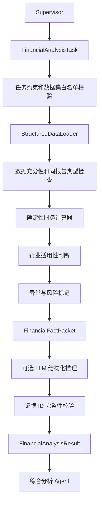

# 财务分析 Agent 设计（v1.0）

## 边界

财务 Agent 只读取指定股票 `cleaned/` 下的白名单结构化 JSON/JSONL。它不读取
PDF、PDF 处理产物、`raw/` 或 `pretty/`，不访问网络、不调用爬虫，也不输出买卖建议。

用户问题理解、任务路由和数据补充由 Supervisor 负责。财务 Agent 不接收用户问题，只接收
`FinancialAnalysisTask`，输出稳定的 `FinancialAnalysisResult` 给综合分析 Agent。
当前实现支持 LangGraph 子图和统一配置的 DeepSeek LangChain 模型，同时保留无模型的离线
回退模式。

## 流程



## Supervisor 输入契约

```python
task = FinancialAnalysisTask(
    task_id="financial-0001",
    stock_code="000001",
    topics=("growth", "profitability", "earnings_quality"),
    report_type="annual",
    max_periods=3,
    dataset_names=(
        "company_profile",
        "financial_indicators",
        "income_statements",
        "cash_flow_statements",
    ),
    constraints=FinancialTaskConstraints(require_llm=True),
)
```

`constraints` 强制禁止 PDF、网络、爬虫和投资建议。即使 Supervisor 误传开放权限，财务
Agent 也会在读取数据前拒绝任务。

## 允许的数据集

- 核心：`financial_summary`、`financial_indicators`、`balance_sheets`、
  `income_statements`、`cash_flow_statements`
- 辅助：`company_profile`、`dividends`、`stock_structure`、`equity_pledges`、
  `restricted_unlocks`

加载器只接受 `get_stock.agent_config.dataset_whitelists` 中
`FINANCIAL_DATASET_FILES` 注册的数据集名称，调用方不能传入任意文件路径。正式输入固定来自
`cleaned/`；`pretty/` 只是人工镜像，不参与分析。

## 支持的分析主题

| 主题 | 代码 | 主要来源 |
| --- | --- | --- |
| 成长能力 | `growth` | 财务指标 |
| 盈利能力 | `profitability` | 财务指标 |
| 盈利质量 | `earnings_quality` | 利润表、现金流量表 |
| 资产负债结构 | `balance_sheet` | 资产负债表 |
| 偿债能力 | `solvency` | 财务指标 |
| 运营效率 | `operating_efficiency` | 财务指标 |
| 现金流 | `cash_flow` | 现金流量表 |
| 分红能力 | `dividend` | 分红记录 |
| 股本结构 | `capital_structure` | 股本结构记录 |

分析主题完全由 Supervisor 写入任务。CLI 中的自然语言解析只用于开发调试，模拟 Supervisor，
不属于财务 Agent 内部流程。

## 报告期规则

- `report_type`、日期范围和期数由 Supervisor 提供。
- 不混合年度、半年度和季度累计值。
- `years` 在第一版表示最多读取多少个同类报告期，范围为 1～10。
- 数据少于请求期数时返回 `partial` 和非阻断缺失项；完全没有必需数据时相应主题不生成结论。
- 第一版不进行机械年化。

## 数值和行业规则

- 三张报表使用中文科目别名映射，兼容“营业收入/营业总收入”“总资产/资产总计”等差异。
- 数学运算由 Python 完成；输出结果以 `evidence_id` 绑定数据集、报告期、字段、值和单位。
- 当前三张报表未显式存储金额单位，绝对金额标记为 `source_statement_unit`，不擅自换算为元。
- 同期利润表与现金流量表来自同一接口体系，因此可计算不受金额单位影响的比率，并在
  `derivation` 中记录公式。
- 银行、保险、证券等金融企业不套用普通公司的资产负债率、流动比率阈值，相关评级返回
  `industry_context_required`。

## 状态

- `completed`：所有请求主题都有结构化证据，且没有数据覆盖缺口。
- `partial`：至少一个主题完成，但部分主题或请求期数不足。
- `insufficient_data`：没有任何请求主题可以形成有证据的结论。

数据不足时结果交回 Supervisor，由 Supervisor 决定是否调用采集 Agent；财务 Agent 自己不会
补充数据。

## LangChain 与 LangGraph

安装可选依赖：

```powershell
python -m pip install -e ".[agent,deepseek-agent]"
```

统一模型配置位于 `get_stock.config.AppSettings`：

```text
provider     = deepseek
model        = deepseek-v4-pro
base_url     = https://api.deepseek.com
temperature  = 0
timeout      = 120 seconds
```

模型名等非敏感设置可以通过 `GET_STOCK_LLM_*` 环境变量覆盖。密钥不设置默认值，也不写入
任务或配置示例，使用 `DEEPSEEK_API_KEY` 人工提供。

Supervisor 创建 Reasoner：

```python
from get_stock.financial_agent import (
    FinancialAnalysisAgent,
    build_deepseek_reasoner,
    build_financial_graph,
)
from get_stock.config import app_settings

reasoner = build_deepseek_reasoner(
    api_key=manually_supplied_api_key,
    model_name=app_settings.llm_model,
    base_url=app_settings.llm_base_url,
    temperature=app_settings.llm_temperature,
    timeout=app_settings.llm_timeout_seconds,
)
agent = FinancialAnalysisAgent(data_dir, reasoner=reasoner)
graph = build_financial_graph(agent)
state = graph.invoke({"task": task.model_dump(mode="json")})
financial_result = state["result"]
```

子图固定为三个节点：`prepare_structured_facts`、`financial_llm_reasoning`、
`verify_and_finalize`。LLM只接收压缩后的事实包，不持有文件、网络或爬虫工具。每条非弃权
结论必须引用有效 `evidence_id`。模型输出未通过校验时会被丢弃，并使用已经生成的确定性
财务事实完成输出；降级原因写入 `limitations`。

三个专业 Agent 当前默认 `require_llm=true`。未注入模型时会拒绝有可分析数据的任务，
防止意外跳过模型；仅当调用方显式设置 `require_llm=false` 时使用确定性回退，结果中
`llm_used=false`。完全无可分析数据时不会为生成“数据不足”提示而调用 LLM。

### 人工提供密钥

最安全的本地调试方式是不在命令参数中传密钥，运行 `--llm` 后按隐藏提示输入：

```powershell
python -m get_stock analyze financial "分析000001盈利质量" --llm
```

也可以在当前 PowerShell 会话设置：

```powershell
$env:DEEPSEEK_API_KEY = "你的密钥"
python -m get_stock analyze financial "分析000001盈利质量" --llm
Remove-Item Env:DEEPSEEK_API_KEY
```

如使用 `.env`，从 `.env.example` 复制并手工填写。`.env` 已加入 `.gitignore`。密钥不会进入
`FinancialAnalysisTask`、`FinancialFactPacket`、LangGraph State 或最终结果。

## CLI

```powershell
python -m get_stock analyze financial "全面分析000001最近三年财务情况"
python -m get_stock analyze financial "分析最近三年盈利质量" --stock-code 000001
python -m get_stock analyze financial "分析现金流" --stock-code 000001 --years 5
python -m get_stock analyze financial "分析半年报盈利能力" --stock-code 000001 --output result.json
python -m get_stock analyze financial "分析000001盈利质量" --llm
```

CLI 是 Supervisor 调试适配器。可用参数：`--stock-code`、`--years`、`--report-type`、
`--llm/--no-llm`、`--data-dir`、`--output`。
