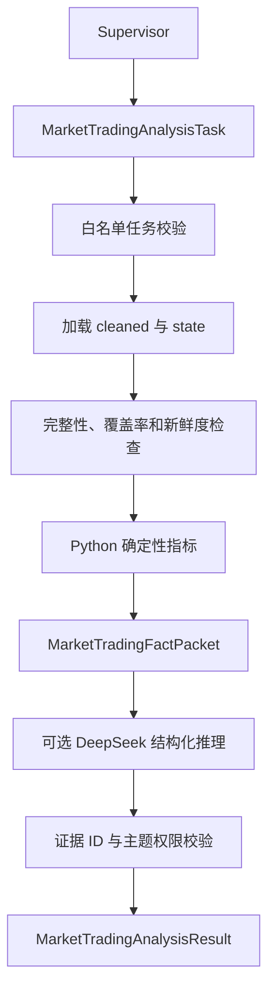

# 市场交易 Agent 设计（v1.0）

## 边界

`MarketTradingAnalysisAgent` 只读取指定股票 `cleaned/` 和允许的 `state/`
文件。它不访问网络、不调用爬虫、不读取 PDF、不预测未来价格，也不提供投资建议。
用户问题解析只存在于 CLI 调试适配器中；生产环境由 Supervisor 生成
`MarketTradingAnalysisTask`。

## 数据访问白名单

财务 Agent 与市场交易 Agent 的文件访问白名单统一配置在
`get_stock.agent_config.dataset_whitelists`：

- `FINANCIAL_DATASET_FILES`：财务 Agent 可访问的 cleaned 文件。
- `MARKET_TRADING_DATASET_FILES`：市场交易 Agent 可访问的 cleaned 文件。
- `MARKET_TRADING_STATE_FILES`：市场交易 Agent 可访问的采集状态文件。
- `MARKET_TRADING_STATE_KEYS`：数据集与 Spider 状态键之间的映射。

主题目录只描述分析依赖，不再隐式授予文件访问权限。新增数据集时必须同时显式更新
白名单和对应测试。

## 支持主题

| 主题 | 代码 | 必需数据 |
| --- | --- | --- |
| 价格趋势 | `price_trend` | `market_history` |
| 波动风险 | `volatility` | `market_history` |
| 流动性 | `liquidity` | `market_history` |
| 价量关系 | `price_volume` | `market_history` |
| 估值快照 | `valuation` | `market_snapshot` |
| 融资融券 | `margin_activity` | `margin_trading` |
| 大宗交易 | `block_trades` | `block_trades` |

## 执行流程



## 数据不足

- `completed`：所有请求主题均有结果，且没有覆盖缺口。
- `partial`：至少一个主题有结果，但数据过期、期间不足或交叉数据缺失。
- `insufficient_data`：没有请求主题能形成指标；不调用 LLM。
- JSON/JSONL 损坏属于数据质量错误，任务直接失败。

空的大宗交易文件必须结合 `trading_crawl_state.json` 判断。若 Spider 成功且记录数为
零，Agent 输出“范围内无大宗交易”的有效事实；若采集失败，则输出可恢复的数据缺失项。

## CLI 调试

CLI 默认启用 DeepSeek。离线确定性分析必须显式关闭 LLM：

```powershell
python -m get_stock analyze market "分析000001最近20个交易日的股价和两融" `
  --sessions 20 `
  --no-llm
```

使用统一 DeepSeek 配置：

```powershell
python -m get_stock analyze market "分析000001最近20个交易日的股价和两融" `
  --sessions 20 `
  --llm
```

`.env` 中的 `DEEPSEEK_API_KEY`、模型、地址、温度和超时配置与财务 Agent 共用。
没有配置密钥时 CLI 使用隐藏输入提示。

## LangGraph 子图

```python
from get_stock.config import app_settings
from get_stock.market_trading_agent import (
    MarketTradingAnalysisAgent,
    build_deepseek_market_reasoner,
    build_market_trading_graph,
)

reasoner = build_deepseek_market_reasoner(
    api_key=app_settings.deepseek_api_key,
    model_name=app_settings.llm_model,
    base_url=app_settings.llm_base_url,
    temperature=app_settings.llm_temperature,
    timeout=app_settings.llm_timeout_seconds,
)
agent = MarketTradingAnalysisAgent(data_dir, reasoner=reasoner)
graph = build_market_trading_graph(agent)
state = graph.invoke({"task": task.model_dump(mode="json")})
market_result = state["result"]
```

LLM 仅接收压缩后的事实包。非弃权结论必须引用存在的 `evidence_id`。
`MarketTradingClaim.topic` 使用 `Literal` 枚举，并进一步限制为本次 `requested_topics`。
模型输出未通过 Topic 或 Evidence 校验时自动使用确定性分析，结果中的 `llm_used=false`，
降级原因写入 `limitations`。
`allowed_claim_types` 必须允许该结论主题，避免使用价格证据支撑融资或估值结论。
