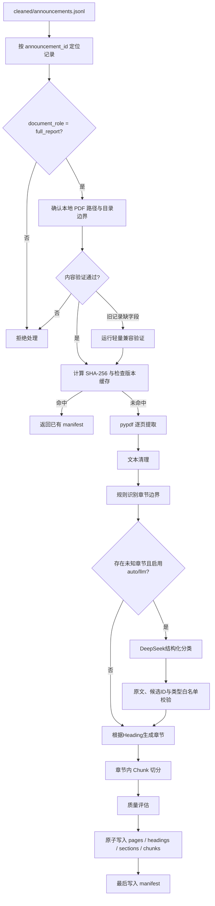

# PDF 处理模块设计（v1.1）

## 边界

本模块只处理已经下载到本地、且被识别并验证为完整年度报告或完整半年度报告的 PDF。
它不负责爬取、不做事实抽取、不连接向量库或调用下游 Agent。章节分类可选调用 LangChain
接入的 DeepSeek，但模型只能处理程序从原文确认的 heading 候选。

## 处理流程



## 输入契约

公告注册表记录至少需要：

- `stock_code`、`announcement_id`、`title`
- `document_role=full_report`
- `report_type`、`report_period`
- `local_path`
- `content_validation_status=passed` 和 `analysis_eligible=true`

为兼容旧爬取数据，如果记录缺少角色或验证字段，入口会根据标题补分类，并对本地 PDF
执行既有的轻量完整报告验证。明确验证失败的记录不会被绕过。

## 输出契约

每份报告写入 `data/stocks/<stock_code>/processed/reports/<announcement_id>/`：

| 文件 | 内容 | 主要溯源字段 |
| --- | --- | --- |
| `pages.jsonl` | 清洗后的逐页文本与页面提取状态 | `announcement_id`、`page_number` |
| `headings.jsonl` | 章节边界、原始标题、标准类型和分类方式 | `candidate_id`、`page_number` |
| `sections.jsonl` | 章节文本、规范章节类型和页码范围 | `section_id`、`start_page`、`end_page` |
| `chunks.jsonl` | 不跨章节的文本块 | `chunk_id`、`section_id`、起止页码 |
| `manifest.json` | 输入、参数、版本、质量指标与输出清单 | PDF SHA-256、处理器版本 |

`sections.jsonl` 和 `chunks.jsonl` 是后续检索或 Agent 可以消费的数据契约，但 v1.1
不会主动把它们发送给任何下游组件。

## 处理规则

- 提取：使用 `pypdf` 逐页提取；单页失败时记录失败页并继续处理其他页面。
- 清洗：执行 Unicode 规范化，移除空行、独立页码和跨页高频页眉页脚。
- 章节边界：忽略目录页；已知“第 X 章/节”和未知“第 X 章”都会建立边界，未知类型保存为
  `unclassified`，不会并入上一章。
- LLM：`auto` 模式只把未分类候选交给 DeepSeek，`llm` 模式复核全部候选。模型只能返回
  已授权 `candidate_id` 的类型和规范标题；标题改变原文含义、置信度低于 0.65、候选越权或
  调用失败时保留规则结果。
- Chunk：只在同一章节内切分，默认最大 1,200 字符、重叠 150 字符，保留页码范围。
- OCR：文本量不足时标记 `requires_ocr`，第一版不自动执行 OCR。

## 状态与缓存

单份报告的状态记录在 `manifest.json`：

- `success`：文本覆盖率达标、没有页面提取失败且至少识别出一个正式章节。
- `partial`：仍有可用文本，但页面覆盖、提取或章节识别不完整。
- `requires_ocr`：几乎没有可提取文本，通常是扫描件。

缓存同时比较源 PDF SHA-256、处理器各阶段版本、`chunk_size`、`chunk_overlap`、
`heading_mode` 和 `heading_reasoner_id`。
任一项变化都会重新处理。处理期间创建排他锁文件，避免同一报告被两个进程同时写入；
数据文件使用临时文件替换，`manifest.json` 最后写入，因此它也是一次完整处理的提交标志。

## CLI

```powershell
python -m get_stock pdf list 000001
python -m get_stock pdf process 000001 <announcement_id>
python -m get_stock pdf process-all 000001
```

可选参数：`--force`、`--chunk-size`、`--chunk-overlap`、`--heading-mode`、`--data-dir`。

- `rules`：完全离线，只使用规则。
- `auto`：CLI 默认值；规则优先，只在存在未分类章节时调用已配置的 DeepSeek。没有密钥时
  安全保留规则结果。
- `llm`：复核全部候选；没有 `.env` 密钥时提示输入。
