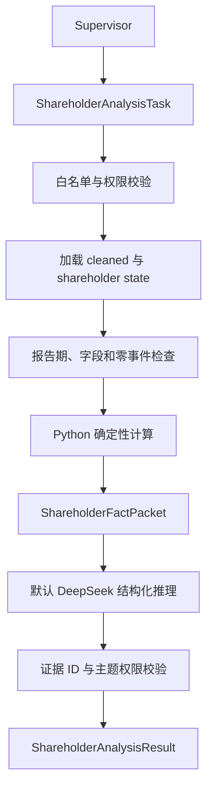

# 股东分析 Agent 设计（v1.0）

## 边界

`ShareholderAnalysisAgent` 只读取白名单中的 `cleaned/` 和股东采集状态文件。
它不访问网络、不调用爬虫、不读取 PDF，不推断实际控制关系、一致行动关系或股东动机，
也不预测股价或提供投资建议。

生产环境由 Supervisor 生成 `ShareholderAnalysisTask`。CLI 的自然语言规则解析只用于
开发调试，不属于股东 Agent 内部职责。

## 白名单

白名单统一配置于 `get_stock.agent_config.dataset_whitelists`：

- `SHAREHOLDER_DATASET_FILES`
- `SHAREHOLDER_STATE_FILES`
- `SHAREHOLDER_STATE_KEYS`

允许的数据包括股本结构、股东人数、基金持股、十大股东、十大流通股东、限售解禁和
股权质押。加载器拒绝任意文件路径及未注册的数据集。

## 支持主题

| 主题 | 代码 |
| --- | --- |
| 股本结构 | `ownership_structure` |
| 股东集中度 | `shareholder_concentration` |
| 主要股东变化 | `major_holder_changes` |
| 股东人数 | `shareholder_count` |
| 基金持股 | `fund_holdings` |
| 限售解禁 | `restricted_unlocks` |
| 股权质押 | `equity_pledges` |

## 流程



## 数据不足

- `completed`：全部请求主题有证据且没有覆盖缺口。
- `partial`：至少一个主题完成，但部分主题或报告期不足。
- `insufficient_data`：没有任何主题可形成证据，不调用 LLM。
- 损坏的 JSON/JSONL 作为数据质量错误直接终止。

`restricted_unlocks` 和 `equity_pledges` 的空文件必须结合
`shareholder_crawl_state.json`。采集成功且记录数为零是有效的“接口未返回事件”事实；
采集失败则返回 `crawl_failed` 和 `recommended_action=crawl_shareholders`。

## 计算限制

- 流通股本不等于自由流通股本。
- 十大股东和十大流通股东分别统计，不能相加。
- 股东名称只做 NFKC、空格等保守标准化，不做模糊主体合并。
- 基金合计持股单位尚未标准化，不与万股单位的股本直接计算比例。
- 质押数据按事件统计，不累加为实时质押余额。
- 解禁事件只描述日期、数量和比例，不推断实际减持或价格方向。

## 默认 LLM

`ShareholderClaim.topic` 使用 `Literal` 枚举，因此 Function Calling Schema 会向模型暴露
全部合法 Topic。事实包同时包含 `allowed_topics` 与本次 `requested_topics`；校验器要求每条
Claim 的 Topic 属于本次任务，并检查 Evidence 的主题权限。模型输出非法 Topic、越界 Topic
或无效 Evidence 时，Agent 丢弃该模型输出并降级到确定性分析，不丢失已经生成的规则证据。

三个专业 Agent 的任务约束现在都默认 `require_llm=true`。CLI 也默认启用 `--llm`，
从项目 `.env` 读取统一 DeepSeek 配置。需要离线确定性输出时必须显式使用
`--no-llm`。

```powershell
python -m get_stock analyze shareholders "分析000001最近4期的股东变化和基金持股"
```

离线模式：

```powershell
python -m get_stock analyze shareholders "分析000001最近4期的股东变化和基金持股" `
  --no-llm
```

## LangGraph

```python
from get_stock.config import app_settings
from get_stock.shareholder_agent import (
    ShareholderAnalysisAgent,
    build_deepseek_shareholder_reasoner,
    build_shareholder_graph,
)

reasoner = build_deepseek_shareholder_reasoner(
    api_key=app_settings.deepseek_api_key,
    model_name=app_settings.llm_model,
    base_url=app_settings.llm_base_url,
    temperature=app_settings.llm_temperature,
    timeout=app_settings.llm_timeout_seconds,
)
agent = ShareholderAnalysisAgent(data_dir, reasoner=reasoner)
graph = build_shareholder_graph(agent)
state = graph.invoke({"task": task.model_dump(mode="json")})
shareholder_result = state["result"]
```
